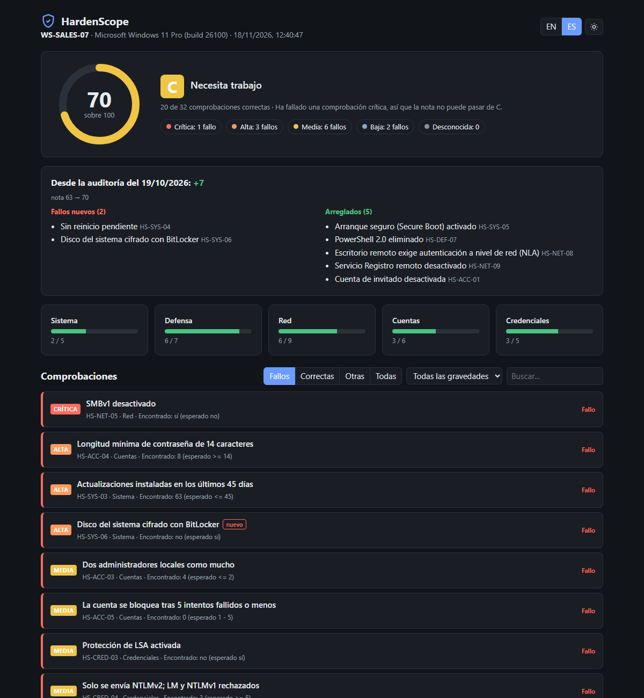
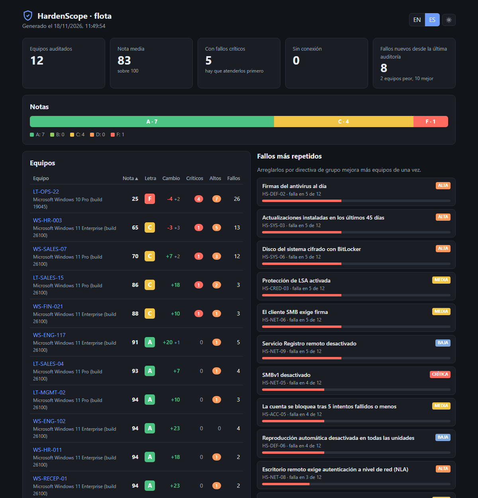

# HardenScope

**Auditoría de bastionado de solo lectura para equipos Windows.** Un script de PowerShell revisa 33 ajustes de seguridad según los CIS Benchmarks y la línea base de seguridad de Microsoft, le pone al equipo una nota de 0 a 100 y genera un informe HTML que explica cada fallo: el riesgo, cómo arreglarlo y el comando de PowerShell para hacerlo.

[Read in English](README.md)



Audita una oficina entera por WinRM y mira qué arreglos ayudan a más equipos:



## Para qué sirve

La mayoría de las empresas no sabe bien cómo están configurados sus equipos hasta que pasa algo. La directiva NIS2 y las aseguradoras ya lo piden. HardenScope responde en unos segundos a "¿cuánto riesgo tiene este equipo y qué arreglo primero?", sin instalar nada y sin cambiar ningún ajuste.

## Qué hace

- **33 comprobaciones en 5 áreas:** sistema, defensa, red, cuentas y credenciales.
- **Nota ponderada:** crítica 10, alta 6, media 3, baja 1. Si falla una comprobación crítica, la nota no pasa de C.
- **Informe útil:** un único HTML (no necesita internet) en español e inglés, con tema claro y oscuro, filtros y un botón para copiar cada comando.
- **Solo lectura y sin permisos de administrador:** un test comprueba que el recolector no contiene ningún comando que pueda cambiar el equipo.
- **Funciona en cualquier idioma de Windows.**
- **La línea base son datos:** las reglas están en [`config/baseline.json`](config/baseline.json).
- **Flotas enteras por WinRM:** `-ComputerName` o `-ComputerListPath` audita muchos equipos en paralelo sin instalarles nada. El informe de la flota ordena los equipos y lista los fallos que más se repiten, los que conviene arreglar por directiva de grupo.
- **Cambios desde la última auditoría:** cada ejecución se compara con la anterior del mismo equipo: cambio de nota, lo arreglado y los fallos nuevos. `-FailOnRegression` devuelve el código 3 si algo que pasaba ahora falla.
- **Parte del ecosistema:** `-PCScopePath` audita los equipos del inventario de PCScope y `-DeskScopeUrl` envía el informe a DeskScope, que abre un ticket por equipo y fallo y lo resuelve solo cuando se arregla:

  ```powershell
  $env:DESKSCOPE_TOKEN = '<token de la API de DeskScope>'
  .\HardenScope.ps1 -PCScopePath \servidor\it\pcscope\data -DeskScopeUrl https://desk.corp.example.com -DeskScopeSeverity critical, high
  ```
- **Modo oscuro:** los informes siguen el tema del sistema y tienen un botón claro/oscuro.
- **Preparado para automatizar:** `-FailOn high` devuelve el código 2 si falla algo de esa gravedad.

## Uso

```powershell
git clone https://github.com/DavidGoRi/HardenScope.git
cd HardenScope
powershell -ExecutionPolicy Bypass -File .\HardenScope.ps1 -Open -Language es
```

Varios equipos por WinRM:

```powershell
.\HardenScope.ps1 -ComputerListPath .\equipos.txt -Credential (Get-Credential CORP\it.admin) -Open -Language es
```

Con los 12 equipos de demostración (ficticios; `demo\previous` es la misma flota un mes antes):

```powershell
.\HardenScope.ps1 -FactsPath .\demo\previous\*.json -Quiet
.\HardenScope.ps1 -FactsPath .\demo\*.json -Open -Language es
```

## Comprobaciones

| Id | Gravedad | Comprobación |
|---|---|---|
| HS-SYS-01 | crítica | La versión de Windows sigue recibiendo parches de seguridad |
| HS-SYS-02 | crítica | La edición LTSC es una versión con soporte |
| HS-SYS-03 | alta | Actualizaciones instaladas en los últimos 45 días |
| HS-SYS-04 | baja | Sin reinicio pendiente |
| HS-SYS-05 | alta | Arranque seguro (Secure Boot) activado |
| HS-SYS-06 | alta | Disco del sistema cifrado con BitLocker |
| HS-DEF-01 | crítica | Hay un antivirus activo |
| HS-DEF-02 | alta | Firmas del antivirus al día |
| HS-DEF-03 | media | Protección contra alteraciones de Defender activada |
| HS-DEF-04 | alta | Control de cuentas de usuario (UAC) activado |
| HS-DEF-05 | media | UAC pide confirmación a los administradores |
| HS-DEF-06 | baja | Reproducción automática desactivada en todas las unidades |
| HS-DEF-07 | media | PowerShell 2.0 eliminado |
| HS-NET-01 | crítica | Cortafuegos activado: perfil de dominio |
| HS-NET-02 | crítica | Cortafuegos activado: perfil privado |
| HS-NET-03 | crítica | Cortafuegos activado: perfil público |
| HS-NET-04 | media | El cortafuegos bloquea el tráfico entrante no solicitado |
| HS-NET-05 | crítica | SMBv1 desactivado |
| HS-NET-06 | media | El cliente SMB exige firma |
| HS-NET-07 | media | Resolución de nombres LLMNR desactivada |
| HS-NET-08 | alta | Escritorio remoto exige autenticación a nivel de red (NLA) |
| HS-NET-09 | baja | Servicio Registro remoto desactivado |
| HS-ACC-01 | media | Cuenta de invitado desactivada |
| HS-ACC-02 | media | Cuenta Administrador integrada desactivada |
| HS-ACC-03 | media | Dos administradores locales como mucho |
| HS-ACC-04 | alta | Longitud mínima de contraseña de 14 caracteres |
| HS-ACC-05 | media | La cuenta se bloquea tras 5 intentos fallidos o menos |
| HS-ACC-06 | baja | La pantalla se bloquea tras 15 minutos de inactividad |
| HS-CRED-01 | crítica | Sin inicio de sesión automático |
| HS-CRED-02 | alta | WDigest no guarda contraseñas en memoria |
| HS-CRED-03 | media | Protección de LSA activada |
| HS-CRED-04 | media | Solo se envía NTLMv2; LM y NTLMv1 rechazados |
| HS-CRED-05 | media | Los anónimos no pueden listar las cuentas |

## Hoja de ruta

1. ~~Auditoría local, línea base, nota e informe HTML~~
2. ~~Varios equipos a la vez por WinRM e informe de la flota~~
3. ~~Cambios entre dos ejecuciones~~
4. ~~Integración con PCScope y DeskScope (un ticket por cada fallo crítico)~~ (esta versión)
5. Versión 1.0.0 con demo en vivo

Los equipos de demostración son ficticios. No publiques los informes de `output\`: describen los fallos de seguridad de un equipo real.

## Licencia

[MIT](LICENSE)
