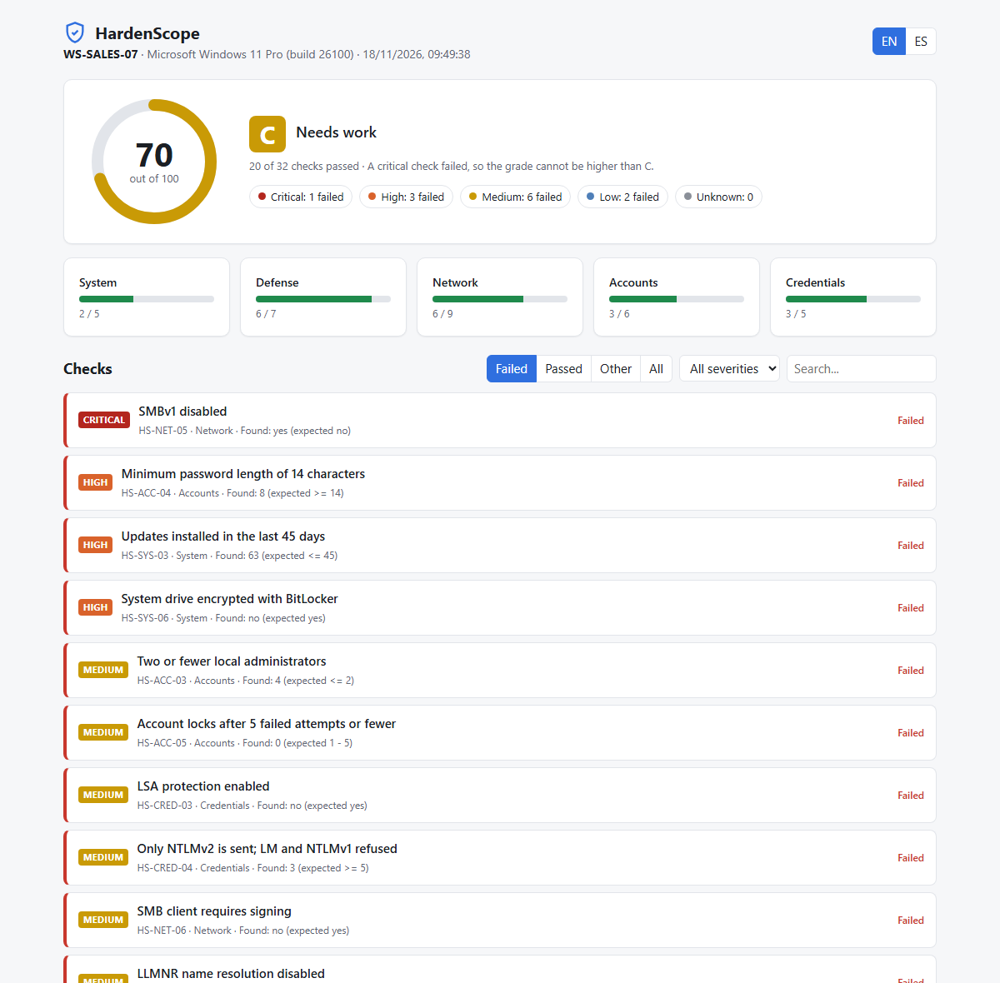

# HardenScope

**Read-only security hardening audit for Windows workstations.** One PowerShell script checks 33 security settings against the CIS Benchmarks and the Microsoft Security Baseline, gives the computer a score from 0 to 100 and writes an HTML report that explains every failed check: the risk, how to fix it and the PowerShell command to do it.

[Leer en español](README.es.md)



## Why

Most companies have no clear picture of how their computers are configured until something goes wrong. The NIS2 directive and cyber insurers now ask for that picture. HardenScope answers "how exposed is this computer, and what do I fix first?" in a few seconds, without installing anything and without changing a single setting.

## Features

- **33 checks in 5 areas:** system (supported Windows version, updates, Secure Boot, BitLocker), defense (antivirus, signatures, tamper protection, UAC, AutoRun, PowerShell 2.0), network (firewall, SMBv1, SMB signing, LLMNR, RDP with NLA, Remote Registry), accounts (guest, built-in administrator, local administrators, password and lockout policy, screen lock) and credentials (automatic logon, WDigest, LSA protection, NTLMv2, anonymous enumeration).
- **Weighted score and grade:** critical 10, high 6, medium 3, low 1. A failed critical check caps the grade at C, however good the rest is.
- **Actionable report:** a self-contained HTML file (no internet needed) in English and Spanish, light and dark theme, filters by status and severity, and a copy button for every fix command.
- **Read-only and no administrator rights needed:** the collector only reads the registry, CIM and built-in cmdlets. A test checks that `src/Facts.ps1` contains no command that could change the computer.
- **Works in any language of Windows:** `net accounts` is parsed by position, not by its translated labels.
- **Baseline as data:** the rules live in [`config/baseline.json`](config/baseline.json). Changing a threshold or adding a rule does not need any code.
- **Ready for automation:** `-FailOn high` returns exit code 2 when a check of that severity fails, so it can run in a scheduled task or a pipeline. Every run also leaves a JSON record.

## Quick start

Windows 10/11 with Windows PowerShell 5.1 (already included in Windows):

```powershell
git clone https://github.com/DavidGoRi/HardenScope.git
cd HardenScope
powershell -ExecutionPolicy Bypass -File .\HardenScope.ps1 -Open
```

Try it with the fictitious demo computers, without reading your own:

```powershell
.\HardenScope.ps1 -FactsPath .\demo\WS-SALES-07.json -Open    # grade C
.\HardenScope.ps1 -FactsPath .\demo\LT-OPS-22.json -Open      # grade F
.\HardenScope.ps1 -FactsPath .\demo\WS-FIN-014.json -Open     # grade A
```

| Parameter | What it does |
|---|---|
| `-Open` | Opens the HTML report when it finishes |
| `-Language en\|es` | Console language (by default, the language of Windows) |
| `-FailOn none\|low\|medium\|high\|critical` | Exit code 2 when a check of that severity or higher fails |
| `-FactsPath <json>` | Evaluates saved facts instead of this computer |
| `-BaselinePath <json>` | Uses another baseline |
| `-OutputPath <folder>` | Where the reports go (by default `output\`) |
| `-Quiet`, `-PassThru` | No console output / return the record as an object |

## How it works

```
src/Facts.ps1      reads the computer  ->  facts  { 'firewall.public': true, 'policy.minPasswordLength': 8, ... }
src/Rules.ps1      facts + config/baseline.json  ->  Pass / Fail / Unknown / NotApplicable  ->  score
src/Report.ps1     JSON record  +  HTML report (src/report-template.html)
```

A rule compares one fact with a value (`eq`, `ne`, `ge`, `le`, `in`, `between`) and can depend on another fact. For example, NLA is only checked when Remote Desktop is on:

```json
{
  "id": "HS-NET-08", "severity": "high",
  "fact": "rdp.nla", "op": "eq", "value": true,
  "when": { "fact": "rdp.enabled", "op": "eq", "value": true }
}
```

A fact that cannot be read (because a cmdlet is missing or needs administrator rights) gives `Unknown`. It does not count towards the score and the report says why.

## Checks

| Id | Severity | Check |
|---|---|---|
| HS-SYS-01 | critical | Windows version still receives security updates |
| HS-SYS-02 | critical | LTSC edition is a supported release |
| HS-SYS-03 | high | Updates installed in the last 45 days |
| HS-SYS-04 | low | No restart pending |
| HS-SYS-05 | high | Secure Boot enabled |
| HS-SYS-06 | high | System drive encrypted with BitLocker |
| HS-DEF-01 | critical | An antivirus is active |
| HS-DEF-02 | high | Antivirus signatures up to date |
| HS-DEF-03 | medium | Defender tamper protection on |
| HS-DEF-04 | high | User Account Control (UAC) enabled |
| HS-DEF-05 | medium | UAC asks administrators before elevating |
| HS-DEF-06 | low | AutoRun disabled on all drives |
| HS-DEF-07 | medium | PowerShell 2.0 removed |
| HS-NET-01 | critical | Firewall on: domain profile |
| HS-NET-02 | critical | Firewall on: private profile |
| HS-NET-03 | critical | Firewall on: public profile |
| HS-NET-04 | medium | Firewall blocks unsolicited inbound traffic |
| HS-NET-05 | critical | SMBv1 disabled |
| HS-NET-06 | medium | SMB client requires signing |
| HS-NET-07 | medium | LLMNR name resolution disabled |
| HS-NET-08 | high | Remote Desktop requires Network Level Authentication |
| HS-NET-09 | low | Remote Registry service disabled |
| HS-ACC-01 | medium | Guest account disabled |
| HS-ACC-02 | medium | Built-in Administrator account disabled |
| HS-ACC-03 | medium | Two or fewer local administrators |
| HS-ACC-04 | high | Minimum password length of 14 characters |
| HS-ACC-05 | medium | Account locks after 5 failed attempts or fewer |
| HS-ACC-06 | low | Screen locks after 15 minutes idle |
| HS-CRED-01 | critical | No automatic logon |
| HS-CRED-02 | high | WDigest does not keep passwords in memory |
| HS-CRED-03 | medium | LSA protection enabled |
| HS-CRED-04 | medium | Only NTLMv2 is sent; LM and NTLMv1 refused |
| HS-CRED-05 | medium | Anonymous users cannot list accounts |

## Tests

180 Pester tests and PSScriptAnalyzer run on every push in GitHub Actions (Windows PowerShell 5.1). They cover the rule engine, the parsers (`net accounts` in English and Spanish, the Security Center product state), the collectors with mocks, a live run on the CI computer, the HTML report and the exit codes.

```powershell
Invoke-Pester -Path .\tests
```

## Roadmap

1. ~~Local audit, baseline, score and HTML report~~ (this version)
2. Several computers at once over WinRM and a fleet report
3. Changes between two runs (what got better, what got worse)
4. Integration with [PCScope](https://github.com/DavidGoRi/PCScope) (computer list) and [DeskScope](https://github.com/DavidGoRi/DeskScope) (a ticket for every critical failure)
5. Version 1.0.0 with a live demo

## Part of a portfolio

HardenScope is the fifth of a set of IT administration tools: [PCScope](https://github.com/DavidGoRi/PCScope) (inventory), [NetScope](https://github.com/DavidGoRi/NetScope) (network scanner), [ADFlow](https://github.com/DavidGoRi/ADFlow) (Active Directory joiners and leavers) and [DeskScope](https://github.com/DavidGoRi/DeskScope) (service desk).

The demo computers are fictitious. Never publish the reports in `output\`: they describe the security gaps of a real computer.

## License

[MIT](LICENSE)
