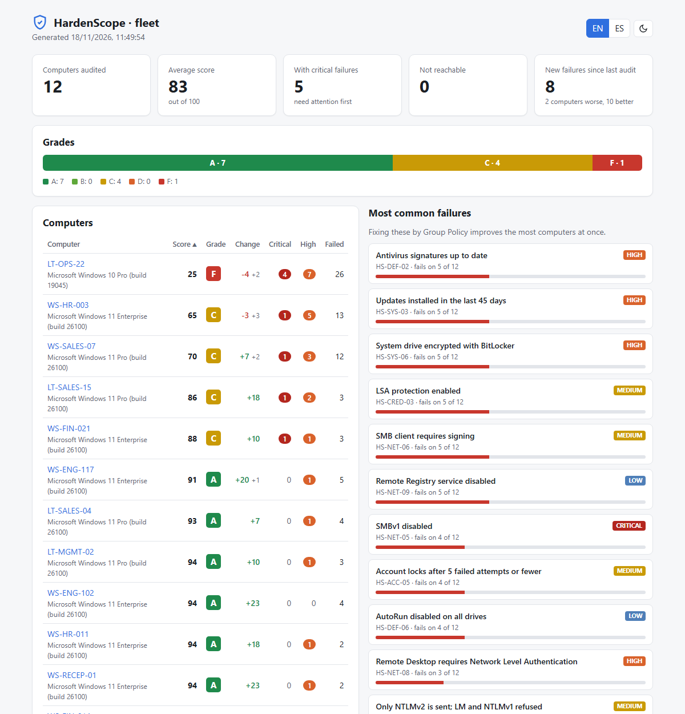

# HardenScope

[](https://github.com/DavidGoRi/HardenScope/actions/workflows/ci.yml)
[](https://github.com/DavidGoRi/HardenScope/releases/latest)
[](https://davidgori.github.io/HardenScope/)
[](LICENSE)

**Read-only security hardening audit for Windows workstations.** One PowerShell script checks 33 security settings against the CIS Benchmarks and the Microsoft Security Baseline, gives the computer a score from 0 to 100 and writes an HTML report that explains every failed check: the risk, how to fix it and the PowerShell command to do it.

**[Live demo](https://davidgori.github.io/HardenScope/)**: real reports of 12 fictitious computers audited twice, a month apart. · [Leer en español](README.es.md)


Audit a whole office at once over WinRM and see which fixes help the most computers:



## Why

Most companies have no clear picture of how their computers are configured until something goes wrong. The NIS2 directive and cyber insurers now ask for that picture. HardenScope answers "how exposed is this computer, and what do I fix first?" in a few seconds, without installing anything and without changing a single setting.

## Features

- **33 checks in 5 areas:** system (supported Windows version, updates, Secure Boot, BitLocker), defense (antivirus, signatures, tamper protection, UAC, AutoRun, PowerShell 2.0), network (firewall, SMBv1, SMB signing, LLMNR, RDP with NLA, Remote Registry), accounts (guest, built-in administrator, local administrators, password and lockout policy, screen lock) and credentials (automatic logon, WDigest, LSA protection, NTLMv2, anonymous enumeration).
- **Weighted score and grade:** critical 10, high 6, medium 3, low 1. A failed critical check caps the grade at C, however good the rest is.
- **Actionable report:** a self-contained HTML file (no internet needed) in English and Spanish, light and dark theme, filters by status and severity, and a copy button for every fix command.
- **Read-only and no administrator rights needed:** the collector only reads the registry, CIM and built-in cmdlets. A test checks that `src/Facts.ps1` contains no command that could change the computer.
- **Works in any language of Windows:** `net accounts` is parsed by position, not by its translated labels.
- **Baseline as data:** the rules live in [`config/baseline.json`](config/baseline.json). Changing a threshold or adding a rule does not need any code.
- **Whole fleets over WinRM:** `-ComputerName` or `-ComputerListPath` audits many computers in parallel without installing anything on them (the collector code travels with the request). The fleet report ranks the computers and lists the checks that fail on most of them, the ones worth fixing by Group Policy. Unreachable computers are listed with the reason.
- **Changes since the last audit:** every run is compared with the previous record of the same computer. The report shows the score change, what got fixed and the new failures (regressions); the fleet report adds a change column and the count of new failures. `-FailOnRegression` exits with code 3 when something that passed now fails.
- **Part of the toolkit:** `-PCScopePath` audits exactly the computers of a [PCScope](https://github.com/DavidGoRi/PCScope) inventory, and `-DeskScopeUrl` sends the fleet report to [DeskScope](https://github.com/DavidGoRi/DeskScope), which opens one ticket per computer and failed check and resolves it by itself when a later audit finds it fixed.
- **Dark mode:** both reports follow the system theme and have a light/dark button; the choice is remembered.
- **Ready for automation:** `-FailOn high` returns exit code 2 when a check of that severity fails, so it can run in a scheduled task or a pipeline. Every run also leaves a JSON record.

## Quick start

Windows 10/11 with Windows PowerShell 5.1 (already included in Windows). Download `HardenScope-x.y.z.zip` from the [latest release](https://github.com/DavidGoRi/HardenScope/releases/latest) (check it against its `.sha256`), unblock it and run:

```powershell
Unblock-File .\HardenScope-1.0.0.zip; Expand-Archive .\HardenScope-1.0.0.zip .
cd .\HardenScope-1.0.0
powershell -ExecutionPolicy Bypass -File .\HardenScope.ps1 -Open
```

Or clone the repository: `git clone https://github.com/DavidGoRi/HardenScope.git`.

Audit several computers over WinRM (remoting must be enabled on them; an account in their Administrators group):

```powershell
.\HardenScope.ps1 -ComputerName PC01, PC02, PC03 -Credential (Get-Credential CORP\it.admin) -Open
.\HardenScope.ps1 -ComputerListPath .\computers.txt -FailOn critical
```

Try it with the 12 fictitious demo computers, without reading any real one (`demo\previous` is the same fleet a month earlier):

```powershell
.\HardenScope.ps1 -FactsPath .\demo\previous\*.json -Quiet    # the audit of a month ago
.\HardenScope.ps1 -FactsPath .\demo\*.json -Open              # today: fleet report with the changes
.\HardenScope.ps1 -FactsPath .\demo\WS-SALES-07.json -Open    # one computer, grade C
```

| Parameter | What it does |
|---|---|
| `-ComputerName <names>` | Computers to audit over WinRM (`localhost` is audited locally) |
| `-ComputerListPath <txt>` | One computer per line; `#` starts a comment |
| `-Credential`, `-ThrottleLimit` | Account for WinRM / computers contacted at the same time (32) |
| `-NoCompare`, `-CompareWith <json>` | Do not compare with the previous audit / compare with a specific record |
| `-FailOnRegression` | Exit code 3 when a check that passed in the previous audit now fails |
| `-PCScopePath <folder\|csv>` | Audits the computers of a PCScope inventory over WinRM |
| `-DeskScopeUrl <url>`, `-DeskScopeSeverity` | Sends the fleet report to DeskScope (token in `DESKSCOPE_TOKEN`); severities that open tickets (`critical`) |
| `-FleetFrom <folder>` | Rebuilds the fleet report from the newest record of every computer in a folder |
| `-Open` | Opens the HTML report (the fleet report when there are several computers) |
| `-Language en\|es` | Console language (by default, the language of Windows) |
| `-FailOn none\|low\|medium\|high\|critical` | Exit code 2 when a check of that severity or higher fails on any computer |
| `-FactsPath <json>` | Evaluates saved facts instead of a computer (wildcards allowed) |
| `-BaselinePath <json>` | Uses another baseline |
| `-OutputPath <folder>` | Where the reports go (by default `output\`) |
| `-Quiet`, `-PassThru` | No console output / return the record as an object |

## With PCScope and DeskScope

```powershell
$env:DESKSCOPE_TOKEN = '<a DeskScope API token>'   # deskscope token create <technician>
.\HardenScope.ps1 -PCScopePath \fileserver\it\pcscope\data -DeskScopeUrl https://desk.corp.example.com -DeskScopeSeverity critical, high
```

1. The computer list comes from PCScope: its data folder (one `<DEVICE>.json` per computer) or its `devices.csv` export.
2. Every computer is audited over WinRM and the fleet report is written as usual.
3. DeskScope receives the fleet summary (no raw facts, no local paths) at `/api/v1/import/hardenscope` and opens a ticket like *OPS-PC04: failed check "Firewall on: public profile"* with the risk, the fix and the PowerShell command, linked to the PCScope device sheet of that computer.
4. On the next run, the tickets of checks that pass again are resolved automatically; computers that could not be reached keep theirs. Running it twice opens nothing new.

If DeskScope cannot be reached or refuses the token, the reports are still saved and HardenScope exits with code 4.

## How it works

```
src/Facts.ps1      reads the computer  ->  facts  { 'firewall.public': true, 'policy.minPasswordLength': 8, ... }
src/Rules.ps1      facts + config/baseline.json  ->  Pass / Fail / Unknown / NotApplicable  ->  score
src/Report.ps1     JSON record  +  HTML report (src/report-template.html)
src/Remote.ps1     sends src/Facts.ps1 over WinRM and gets the facts back as JSON
src/Compare.ps1    current results + previous record of the same computer  ->  fixed / regressed / score change
src/Integrations.ps1  computer list from PCScope, fleet report to DeskScope
src/Fleet.ps1      many records  ->  fleet summary  +  fleet report (src/fleet-template.html)
```

A rule compares one fact with a value (`eq`, `ne`, `ge`, `le`, `in`, `between`) and can depend on another fact. For example, NLA is only checked when Remote Desktop is on:

```json
{
  "id": "HS-NET-08", "severity": "high",
  "fact": "rdp.nla", "op": "eq", "value": true,
  "when": { "fact": "rdp.enabled", "op": "eq", "value": true }
}
```

A fact that cannot be read (because a cmdlet is missing or needs administrator rights) gives `Unknown`. It does not count towards the score and the report says why.

## Checks

| Id | Severity | Check |
|---|---|---|
| HS-SYS-01 | critical | Windows version still receives security updates |
| HS-SYS-02 | critical | LTSC edition is a supported release |
| HS-SYS-03 | high | Updates installed in the last 45 days |
| HS-SYS-04 | low | No restart pending |
| HS-SYS-05 | high | Secure Boot enabled |
| HS-SYS-06 | high | System drive encrypted with BitLocker |
| HS-DEF-01 | critical | An antivirus is active |
| HS-DEF-02 | high | Antivirus signatures up to date |
| HS-DEF-03 | medium | Defender tamper protection on |
| HS-DEF-04 | high | User Account Control (UAC) enabled |
| HS-DEF-05 | medium | UAC asks administrators before elevating |
| HS-DEF-06 | low | AutoRun disabled on all drives |
| HS-DEF-07 | medium | PowerShell 2.0 removed |
| HS-NET-01 | critical | Firewall on: domain profile |
| HS-NET-02 | critical | Firewall on: private profile |
| HS-NET-03 | critical | Firewall on: public profile |
| HS-NET-04 | medium | Firewall blocks unsolicited inbound traffic |
| HS-NET-05 | critical | SMBv1 disabled |
| HS-NET-06 | medium | SMB client requires signing |
| HS-NET-07 | medium | LLMNR name resolution disabled |
| HS-NET-08 | high | Remote Desktop requires Network Level Authentication |
| HS-NET-09 | low | Remote Registry service disabled |
| HS-ACC-01 | medium | Guest account disabled |
| HS-ACC-02 | medium | Built-in Administrator account disabled |
| HS-ACC-03 | medium | Two or fewer local administrators |
| HS-ACC-04 | high | Minimum password length of 14 characters |
| HS-ACC-05 | medium | Account locks after 5 failed attempts or fewer |
| HS-ACC-06 | low | Screen locks after 15 minutes idle |
| HS-CRED-01 | critical | No automatic logon |
| HS-CRED-02 | high | WDigest does not keep passwords in memory |
| HS-CRED-03 | medium | LSA protection enabled |
| HS-CRED-04 | medium | Only NTLMv2 is sent; LM and NTLMv1 refused |
| HS-CRED-05 | medium | Anonymous users cannot list accounts |

## Tests

263 Pester tests and PSScriptAnalyzer run on every push in GitHub Actions (Windows PowerShell 5.1). They cover the rule engine, the parsers (`net accounts` in English and Spanish, the Security Center product state), the collectors with mocks, a live run on the CI computer, remoting with mocks and a real WinRM run against the CI computer, the fleet summary, the comparison between audits, the PCScope and DeskScope integration, the HTML reports (including their dark mode), the release zip, the live demo site and the exit codes.

```powershell
Invoke-Pester -Path .\tests
```

## Roadmap

1. ~~Local audit, baseline, score and HTML report~~
2. ~~Several computers at once over WinRM and a fleet report~~
3. ~~Changes between two runs (what got better, what got worse)~~
4. ~~Integration with [PCScope](https://github.com/DavidGoRi/PCScope) (computer list) and [DeskScope](https://github.com/DavidGoRi/DeskScope) (a ticket for every critical failure)~~
5. ~~Version 1.0.0 with a live demo~~

Possible next steps: more rules (audit policy, Credential Guard, ASR rules), Windows Server baselines and an export to CSV.

## Maintenance

| Script | What it does |
|---|---|
| `tools/New-DemoFacts.ps1` | Writes the fictitious demo computers (fixed seeds, so the files never change by accident) |
| `tools/Build-Demo.ps1` | Builds the live demo site in `_site/` (the Demo workflow publishes it every Monday) |
| `tools/Build-Release.ps1` | Builds `dist/HardenScope-x.y.z.zip` and its `.sha256` |
| `tools/Update-Screenshots.ps1` | Takes the README pictures and `docs/social-preview.png` from the demo (needs Edge) |

To publish a version: change `$script:HSVersion` in `src/Report.ps1`, add its section to `CHANGELOG.md` and push a `vX.Y.Z` tag; the Release workflow builds the zip and the GitHub release.

## Part of a portfolio

HardenScope is the fifth of a set of IT administration tools: [PCScope](https://github.com/DavidGoRi/PCScope) (inventory), [NetScope](https://github.com/DavidGoRi/NetScope) (network scanner), [ADFlow](https://github.com/DavidGoRi/ADFlow) (Active Directory joiners and leavers) and [DeskScope](https://github.com/DavidGoRi/DeskScope) (service desk).

The demo computers are fictitious. Never publish the reports in `output\`: they describe the security gaps of a real computer.

## License

[MIT](LICENSE)
